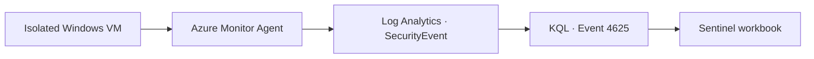

# Microsoft Azure Sentinel Honeypot Lab

A defensive Azure lab for investigating failed Windows Remote Desktop (RDP) sign-ins. It collects Windows Security events in Log Analytics, uses Kusto Query Language (KQL) to summarize repeated failures, and visualizes approximate source locations in a Microsoft Sentinel workbook.



## 1. Set up the lab network

Create a dedicated Azure resource group, virtual network, and supported Windows VM. Use a private VM with management access through Azure Bastion or a private lab network. Keep Windows Defender Firewall enabled and scope RDP access to the approved management path. Run the lab without production data or shared credentials.

## 2. Connect Windows Security events to Sentinel

1. Create a Log Analytics workspace for the lab and onboard it to Microsoft Sentinel.
2. Enable the **Windows Security Events via AMA** connector and create a data collection rule (DCR) targeting the Windows VM. Select the **Minimal** event set or use a custom rule that includes event 4625.
3. On the VM, verify that failed logons are audited. From an authorized lab client, make one intentional failed RDP sign-in and look for Event ID **4625** in the local Security log.
4. In Log Analytics, verify that the event arrives in `SecurityEvent`. For a private lab client, the event can validate ingestion while the synthetic query below validates the map. Review Defender for Cloud separately if you want posture management for the lab.

[Windows security event sets](https://learn.microsoft.com/azure/sentinel/windows-security-event-id-reference) · [Windows event 4625](https://learn.microsoft.com/windows/security/threat-protection/auditing/event-4625)

## 3. Investigate repeated failed RDP sign-ins

```kusto
SecurityEvent
| where TimeGenerated > ago(24h)
| where EventID == 4625 and LogonType == 10
| where isnotempty(IpAddress) and IpAddress != "-"
| summarize Attempts = count(),
            Accounts = dcount(TargetUserName),
            FirstSeen = min(TimeGenerated),
            LastSeen = max(TimeGenerated)
    by SourceIP = IpAddress, Computer
| order by Attempts desc
```

Logon type 10 is RemoteInteractive. Some failed authentication attempts can appear with other logon types, so if the test event is absent, check event 4625 without the logon-type filter and compare it with the VM event log. For triage, review affected accounts, first and last timestamps, and nearby successful sign-ins before drawing conclusions.

## 4. Map source regions in a workbook

Add a query to a Sentinel workbook, select the lab workspace, and paste the following KQL. Choose **Map**, select **Latitude/Longitude**, and assign `Latitude`, `Longitude`, and `Attempts` to the coordinate and size fields. Use `Country` as the label.

```kusto
SecurityEvent
| where TimeGenerated > ago(24h)
| where EventID == 4625 and LogonType == 10
| where isnotempty(IpAddress) and IpAddress != "-"
| summarize Attempts = count() by SourceIP = IpAddress
| extend Location = geo_info_from_ip_address(SourceIP)
| extend Latitude = todouble(Location.latitude),
         Longitude = todouble(Location.longitude),
         Country = tostring(Location.country)
| where isnotnull(Latitude) and isnotnull(Longitude)
| summarize Attempts = sum(Attempts) by Latitude, Longitude, Country
| order by Attempts desc
```

IP geolocation is approximate. VPNs, proxies, shared IPs, and hosting providers can affect the apparent location. The query excludes events without usable coordinates from the map.

### Synthetic workbook preview

Use this dataset to check map rendering even if the private lab VM has no geolocatable source IPs. The counts and coordinates below are illustrative.

```kusto
datatable(Latitude:real, Longitude:real, Country:string, Attempts:long)
[
    14.60, 120.98, "Philippines", 80,
    52.52, 13.41, "Germany", 34,
    51.51, -0.13, "United Kingdom", 16,
    41.88, -87.63, "United States", 12
]
```

## 5. Verify and clean up

- Compare the local event timestamp and destination host with the matching record in Log Analytics.
- Check where the map places the four synthetic points and verify that marker size tracks `Attempts`.
- When finished, remove dedicated lab resources you no longer need and review any workspace retention or service charges.

## Reference

[Microsoft Azure Sentinel Honeypot Lab](https://github.com/nuttercd/microsoft-azure-sentinel-honeypot-lab) served as a reference for the lab workflow. This write-up uses Azure Monitor Agent and original KQL. The sample workbook data is synthetic, and this repository does not report results from a live deployment.
